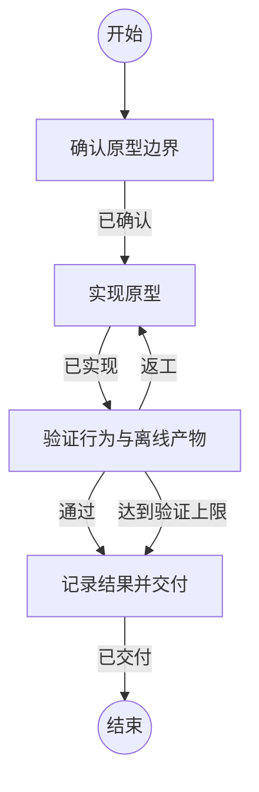

## 确认原型边界

```新建Agent
根据任务确认目标环境、不可改变的功能语义、原型边界和包体积统计口径。区分已确认事实与待验证事项。输入：{outcome}
```

### 已确认

确定原型实现范围、独立验证方式、保留的正式交付及必要环境条件。

## 实现原型

```复用Agent
实现已确认的原型和独立验证入口。使用成熟协议与加密实现，保留现有正式交付。最多进行三轮因验证失败而触发的针对性返工。输入：{outcome}
```

### 已实现

源码、构建入口、测试和文档已具备验证条件。

## 验证行为与离线产物

```复用Agent
运行协议互操作、异常行为、静态链接、无网络启动和完整资产体积检查。逐项记录命令证据与未完成的能力。不得用源码包或裸二进制体积代替完整部署资产。输入：{outcome}
```

### 通过

原型验证通过，资产符合已声明口径和体积目标。

### 返工

存在可在原型边界内修复的问题，尚未达到三轮返工上限。

### 达到验证上限

体积或环境条件尚未达标，或已完成三轮返工。保留准确实测结果和具体原因，不宣布完整重构成功。

## 记录结果并交付

```复用Agent
在负责位置记录已验证原型、测量结果、目标环境和剩余迁移范围。仅提交通过验证的代码，按项目流程交付并清理临时工作目录。输入：{outcome}
```

### 已交付

交付内容和验证证据完整，原型与正式能力状态清楚。
