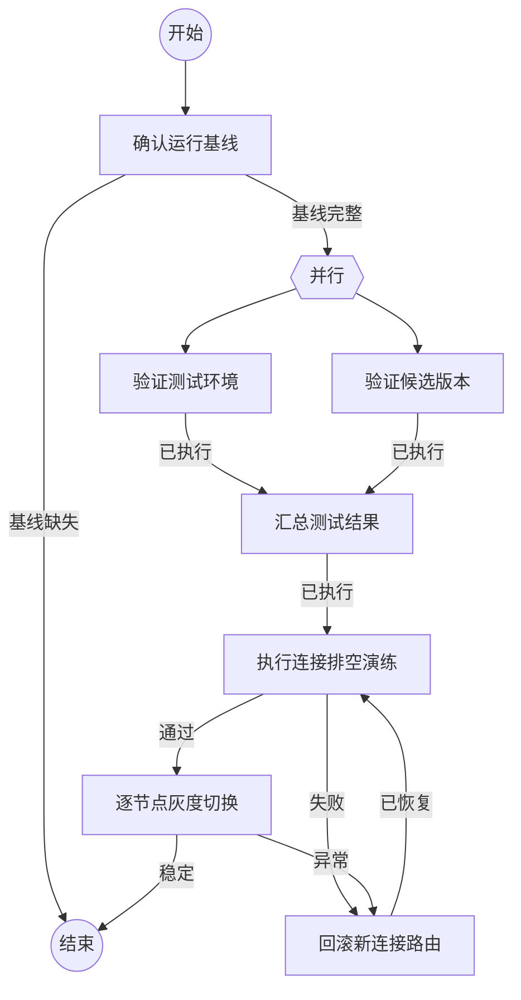

## 确认运行基线

```新建Agent
只读检查当前 remote-exec 的运行版本、端口 owner、启动方式、证书和 token 文件位置、客户端入口、活动连接以及可用回滚材料。确认 xiaomi 可作为隔离测试环境。不要修改文件、启动服务或重启服务。
任务：
{outcome}
```

### 基线完整

已确认运行边界、回滚材料和测试环境，可以开始并行验证。

### 基线缺失

存在会影响升级安全性的未确认事实，停止流程并补齐基线。

## 验证测试环境

```执行自定义命令
{
  "command": "node",
  "args": ["-e", "console.log('测试环境验证由实施者按设计文档执行')"],
  "stdin": {"task": "{outcome}"}
}
```

### 已执行

测试环境具备独立端口、独立凭据和可回滚条件。

## 验证候选版本

```执行自定义命令
{
  "command": "npm",
  "args": ["test"],
  "stdin": {"task": "{outcome}"}
}
```

### 已执行

候选版本通过本地语法、类型、协议、relay 和进程组清理测试。

## 汇总测试结果

```执行自定义命令
{
  "command": "node",
  "args": ["-e", "console.log('根据分支结果执行隔离环境放行判断')"],
  "stdin": {
    "xiaomi": {xiaomi.outcome},
    "package": {package.outcome}
  }
}
```

### 已执行

候选版本和隔离环境均满足演练前置条件。

## 执行连接排空演练

```新建Agent
在不影响正式入口的前提下，启动候选 generation，保持直连流式命令、relay 流式命令和文件传输，切换新连接路由，然后让旧 generation drain。记录活动连接、终态响应、输出顺序、子进程组和旧 generation 退出状态。必要时只在测试环境回滚。
输入：
{outcome}
```

### 通过

既有连接完整排空，新连接进入候选 generation，旧 generation 可在活动归零后退出。

### 失败

排空或回滚证据不足，返回重新执行测试环境和候选版本验证。

## 逐节点灰度切换

```新建Agent
按 xiaomi、NM105、nm108 的顺序执行灰度升级。每个节点先备用端口验证，再切换代理新连接路由，观察活动请求和错误率，保留旧 generation。NM105 与 nm108 不同时切换。任一门禁失败立即把新连接路由回旧 generation。
输入：
{outcome}
```

### 稳定

所有节点完成观察窗口，旧版本和回滚路径仍可用。

### 异常

新版本或链路出现异常，执行回滚并保留诊断材料。

## 回滚新连接路由

```新建Agent
停止向新 generation 分配新连接，把新连接路由回旧 generation，保留旧版本及其配置，确认旧入口的 healthz、readyz、真实 exec 和 relay 均恢复。不要删除新版本日志，不要自动重试状态未知的非幂等请求。
输入：
{outcome}
```

### 已恢复

旧 generation 已恢复服务，保留失败证据并回到连接排空演练。
