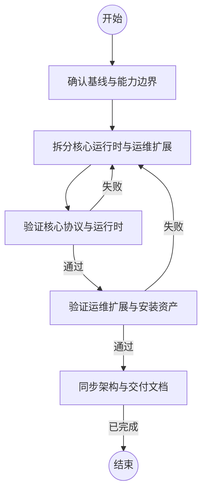

## 确认基线与能力边界

```执行自定义命令
{"command":"bash","args":["-lc","node .agents/architecture-governance/check-state.mjs check && cargo test --manifest-path rust/Cargo.toml --workspace"],"stdin":"{outcome}"}
```

### 已执行

已确认当前架构状态、测试基线和核心能力边界。

## 拆分核心运行时与运维扩展

```新建Agent
在当前 Rust 项目中实施核心运行时与运维扩展分离。保留 TLS/token、exec、exec.stream、RPC 文件读写、HTTPS 大文件上传下载、relay、lifecycle、supervisor 的无中断切换和最小控制协议；把 SSH 部署、安装包处理、升级编排、Node 迁移、交互部署流程移出核心客户端入口。保持外部协议和核心行为不变，先拆职责和构建边界，再删除不可达的入口。不得降低运行用户权限边界，不得删除大文件或无中断能力。完成后提交改动摘要和验证结果。
```

### 已完成

核心运行时与运维扩展已经形成清晰的代码和入口边界。

## 验证核心协议与运行时

```执行自定义命令
{"command":"bash","args":["-lc","cargo fmt --manifest-path rust/Cargo.toml --all -- --check && cargo clippy --manifest-path rust/Cargo.toml --workspace --all-targets -- -D warnings && cargo test --manifest-path rust/Cargo.toml --workspace && node test/rust-prototype/runner.js"],"stdin":"{outcome}"}
```

### 已执行

核心构建、静态检查、单元测试和协议回归均通过。

## 验证运维扩展与安装资产

```执行自定义命令
{"command":"bash","args":["-lc","bash -n scripts/build-rust-release.sh scripts/build-rust-prototype.sh rust/packaging/install.sh && node test/rust-prototype/supervisor.js"],"stdin":"{outcome}"}
```

### 已执行

运维扩展入口、安装脚本和 supervisor 回归通过。

## 同步架构与交付文档

```新建Agent
根据已经完成的代码拆分和验证结果，更新项目架构总览、Rust 运行说明、构建说明和测试映射。明确核心运行时、supervisor 控制面、运维扩展的边界和依赖；不要宣称未验证的能力已经交付。完成后列出修改的文档和依据。
```

### 已完成

架构文档和交付说明已与当前代码边界和验证结果一致。
