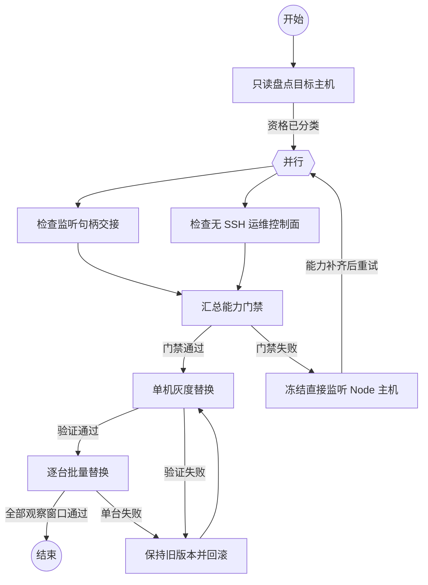

## 只读盘点目标主机

```执行自定义命令
{
  "command": "node",
  "args": [".agents/architecture-governance/check-state.mjs", "check", "--require-active"],
  "stdin": {"task": "{outcome}"}
}
```

### 资格已分类

记录端口 owner、systemd unit、运行用户、凭据位置、是否已有 supervisor、是否有独立恢复通道，并将主机分为可 Rust 升级、可 handoff、暂缓三类。

## 检查监听句柄交接

```执行自定义命令
{
  "command": "rg",
  "args": ["-n", "TcpListener::bind|server.close|systemctl stop|handoff", "rust/daemon", "src/daemon", "rust/ops/src/migrate.rs"],
  "stdin": {"task": "{outcome}"}
}
```

### 已验证

隔离测试已证明：旧 WSS 长请求在 listener handoff 后继续由 Node 完成，新连接进入 Rust supervisor；失败时未关闭 Node。QC101、QC194、QC195 的实际切换则使用了明确维护窗口，三台已验证 systemd service ownership、旧凭据和 Rust supervisor active generation。

## 检查无 SSH 运维控制面

```执行自定义命令
{
  "command": "rg",
  "args": ["-n", "SSH|signature|签名|promote|rollback|drain|retire", "rust/daemon", "rust/ops/src", "docs/operations"],
  "stdin": {"task": "{outcome}"}
}
```

### 已验证

Rust supervisor 已有同 uid 控制面和 `ctl` 的 promote、rollback、drain、retire 能力；但面向首次 Node bootstrap 的签名、nonce、请求 ID、幂等 in-band 运维控制面尚未实现。不能把现有 daemon `exec` 或 SSH 作为生产无 SSH 控制面替代。

## 汇总能力门禁

```执行自定义命令
{
  "command": "git",
  "args": ["diff", "--check"],
  "stdin": {
    "task": "{outcome}",
    "handoff": {"handoff.outcome"},
    "control": {"control.outcome"}
  }
}
```

### 门禁通过

listener handoff 原型、持久托管、回滚和真实协议测试已通过；无 SSH in-band 控制面尚未实现，因此本次仅在获得明确维护窗口并具备 QC71 带外 SSH 的主机上执行首次替换。

### 门禁失败

冻结所有直接监听 Node 主机，不执行 stop/start 切换，保留 Node 作为生产版本。

## 单机灰度替换

```新建Agent
按当前能力门禁选择一台已获批准的非网关主机，执行只允许通过固定入口和已验证控制面的灰度替换。切换前保持 WSS 长连接、exec.stream、上传下载和 relay，切换后逐项核对旧连接完整性、新连接路由和回滚能力。不要使用未经验证的 stop/start 或额外端口。
{outcome}
```

### 验证通过

单机完成观察窗口，旧 generation 归零并保留可回滚资产。

### 验证失败

切回旧 generation，停止候选但不停止固定入口，保存证据并返回灰度节点。

## 逐台批量替换

```执行自定义命令
{
  "command": "npm",
  "args": ["run", "test:rust-upgrade"],
  "stdin": {"task": "{outcome}"}
}
```

### 全部观察窗口通过

QC101、QC194、QC195 已完成首次有中断切换，supervisor active/enabled，原凭据和 `exec`/`exec.stream` 验收通过，并各完成一次 Rust→Rust 无中断升级。其余主机不因本批次结果自动放行，仍需逐台资格检查。

### 单台失败

暂停批次，保持其他主机不变，执行该主机回滚并保留日志、状态和包校验资料。

## 冻结直接监听 Node 主机

```执行自定义命令
{
  "command": "node",
  "args": ["-e", "process.stdout.write('direct-node-hosts-remain-frozen\\n')"],
  "stdin": {"task": "{outcome}"}
}
```

### 能力补齐后重试

剩余直接监听 Node 的主机仍需补齐 handoff 或独立恢复通道后重新进入并行检查；QC101、QC194、QC195 已进入观察期，不再执行 Node 回滚或停止 supervisor 的操作。

## 保持旧版本并回滚

```执行自定义命令
{
  "command": "node",
  "args": ["-e", "process.stdout.write('rollback-required\\n')"],
  "stdin": {"task": "{outcome}"}
}
```

### 已回滚

固定入口仍在运行，旧 generation 已通过真实 TLS、token、exec、stream 和 relay 验收。

## 结束

流程完成。
