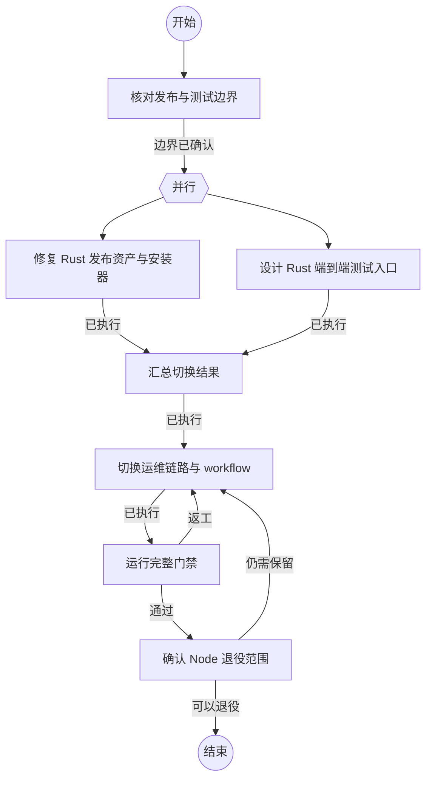

## 核对发布与测试边界

```新建Agent
根据当前代码、发布脚本、安装器和测试入口，确认 Rust 正式切换所需的能力、资产命名和保留的 Node 回滚边界：
{outcome}
```

### 边界已确认

已形成可执行的 Rust 发布切换边界。

## 修复 Rust 发布资产与安装器

```执行自定义命令
{
  "command": "cargo",
  "args": ["metadata", "--manifest-path", "rust/Cargo.toml", "--no-deps", "--format-version", "1"],
  "stdin": {"task": "{outcome}"}
}
```

### 已执行

Rust 发布包和安装器输入已完成核对。

## 设计 Rust 端到端测试入口

```执行自定义命令
{
  "command": "node",
  "args": ["--check", "test/rust-prototype/phase4a.js"],
  "stdin": {"task": "{outcome}"}
}
```

### 已执行

Rust 安装、部署、网关和升级测试入口已完成核对。

## 汇总切换结果

```执行自定义命令
{
  "command": "git",
  "args": ["status", "--short"],
  "stdin": {"task": "{outcome}"}
}
```

### 已执行

已汇总发布和测试切换输入。

## 切换运维链路与 workflow

```新建Agent
在不删除 Node 回滚资产的前提下，实施 Rust 正式发布、安装、rex-ops deploy、网关部署、安装测试、部署测试、升级测试和 release workflow 切换。保持外部协议和回滚语义不变：
{outcome}
```

### 已执行

Rust 正式交付链路已完成切换。

## 运行完整门禁

```执行自定义命令
{
  "command": "cargo",
  "args": ["test", "--manifest-path", "rust/Cargo.toml", "--workspace", "--all-features"],
  "stdin": {"task": "{outcome}"}
}
```

### 通过

Rust workspace、发布和端到端门禁均已通过。

### 返工

验证发现发布、安装、部署或升级回归，返回切换节点修复。

## 确认 Node 退役范围

```新建Agent
根据验证结果判断哪些 Node 代码可以删除，哪些必须作为 Pi 宿主适配或短期回滚资产保留：
{outcome}
```

### 可以退役

已确认可以安全删除的 Node 逻辑范围。

### 仍需保留

仍存在生产回滚、宿主适配或未完成迁移的 Node 逻辑。

## 结束

流程完成。
