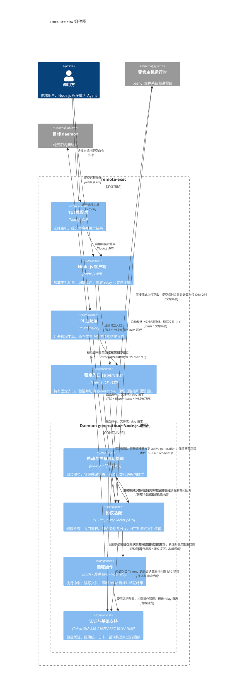

# 架构总览

remote-exec 在受信任的 Linux 主机上通过 TLS、Bearer token 和 JSON-RPC 风格协议交付远程命令、文件传输和单跳 relay。

它是高权限远程执行服务，不是公网零信任管理平台。有效 token 代表 daemon 运行用户的权限范围；部署方负责将服务限制在受信任网络，并以专用非 root 用户运行 daemon。

## 系统边界

图中的 daemon generation 边界对应一个服务进程。协议适配负责 HTTP 文件流并直接访问文件系统，文件 RPC 则由远程操作组件处理。supervisor 管理 generation 切换与回收，daemon 内的生命周期协调管理本进程的请求接纳和资源排空。

| 组件 | 职责 | 代码映射 |
| --- | --- | --- |
| 启动与生命周期协调 | 解析参数、组装服务、处理进程信号，管理就绪状态和资源排空 | `src/daemon/`，关键文件 `main.js`、`lifecycle.js` |
| 协议适配 | HTTP(S) 路由与鉴权、WebSocket 会话与 RPC 分发、HTTP 流式上传下载 | `src/daemon/transport/`，关键文件 `http-server.js`、`rpc-server.js`、`file-transfer.js` |
| 远程操作 | 命令执行、文件 RPC、relay 目标限制和流式转发 | `src/daemon/operations/`，关键文件 `exec.js`、`files.js`、`relay.js` |
| 认证与基础支持 | Token 摘要加载和验证、日志、RPC 错误构造、限额与默认配置 | `src/daemon/shared/`，关键文件 `auth.js`、`log.js`、`rpc-error.js`、`constants.js` |
| 稳定入口 supervisor | 持有固定 TCP 入口，管理 generation 切换、回滚窗口和 retire | `src/supervisor/`，关键文件 `main.js`、`supervisor.js` |
| Node.js 客户端 | 读取主机配置，建立经证书校验的连接，编排直连、单跳 relay 和文件传输 | `src/client/`，关键文件 `host.js`、`transfer.js` |
| TUI 适配层 | 为终端用户调用 Node.js 客户端能力 | `src/tui/`，关键文件 `app.js` |
| Pi 适配层 | 注册远程工具，独立实现受协议回归测试约束的客户端 | `pi-extension/`，关键文件 `remote-exec.ts` |
| 受管主机运行时 | 提供 `bash -lc`、进程组和文件系统 | 外部运行时，由受管 Linux 主机提供 |
| 目标 daemon | 接收网关允许的单跳 RPC 请求 | 外部服务，运行同一 daemon 协议 |

## 稳定边界

daemon generation 通过 HTTP(S) 入口执行健康检查和经 Bearer token 鉴权的 HTTP 文件传输，并把经鉴权的 WebSocket 升级交给 RPC 服务器；固定入口 supervisor 通过原始 TCP 将新连接分配到 active generation。

RPC 服务器只暴露 `exec`、`exec.stream`、`file.read`、`file.write` 和 `relay` 五类方法；每个 WebSocket 会话顺序执行请求，连接关闭时取消仍在执行的操作。

命令执行以 `bash -lc` 启动独立进程组。普通执行收集有限输出；流式执行按固定分片发送输出，在超时或连接中断时终止对应进程组。

文件 RPC 只接受绝对路径。大文件经 `/upload` 与 `/download` 的 HTTPS 流式端点传输，两个端点只支持直连 daemon，不经 relay。

Node.js 客户端负责直连和深度为一的 relay 编排。TUI 依赖 Node.js 客户端；Pi extension 为适应 Pi 虚拟模块环境而保持独立实现，其协议行为以集成测试为依据。

relay 只接受 IPv4 字面量和白名单内目标，只转发 `exec`、`exec.stream`、`file.read` 和 `file.write`，禁止嵌套 relay。网关在连接目标时校验证书，并将目标认证失败、证书失败和不可达状态区分为不同 RPC 错误。

## Daemon 子模块

Daemon 按协议适配、远程操作和共享基础功能组织，启动入口与生命周期协调保留在根目录。文件 RPC 和 HTTP 流式传输分别归属操作层与传输层，Token 认证只处理凭证，日志和 RPC 错误独立供各层使用。

| 模块 | 职责与协作 |
| --- | --- |
| `main.js`、`lifecycle.js` | 入口组装服务并处理进程信号；生命周期管理就绪状态、资源计数和排空，资源所有者注册具体清理回调。 |
| `transport/` | `http-server.js` 管理 HTTP(S) 路由、鉴权和 WebSocket 升级；`rpc-server.js` 管理会话、请求顺序、方法分发和断连取消；`file-transfer.js` 管理 HTTP 文件流、临时文件及响应。 |
| `operations/` | `exec.js` 管理命令进程与输出；`files.js` 处理文件 RPC；`relay.js` 管理目标限制、TLS/WSS 连接和转发。操作通过事件发送及取消注册回调与 RPC 层协作。 |
| `shared/` | `auth.js` 验证 Token；`log.js` 输出日志；`rpc-error.js` 创建 RPC 错误；`constants.js` 定义各层使用的限额和默认值。 |

启动入口组装传输层，传输层调用操作层，各层可使用共享基础功能。共享模块与生命周期协调不依赖传输层或操作层。RPC 会话仍顺序执行请求，HTTP 文件传输仍只支持直连，命令取消与 relay 白名单规则保持原有语义。

## 安全规则

有效 token 可以在 daemon 运行用户权限范围内执行 `bash -lc`，并读写该用户可访问的绝对路径。服务端只保存 token 的 SHA-256，不保存 token 明文。

TLS 模式用于远程监听；`--insecure-http` 只允许回环地址。客户端必须校验证书，部署方必须通过 VPN、防火墙或等效网络控制限制可访问方。

健康检查端点不需要 token；除健康检查外，HTTP 文件端点和 WebSocket 升级都必须先完成 Bearer token 验证。该边界不提供多用户身份、细粒度 RBAC、命令审计或 token 自动轮换。

## 核心动作约束

### 单一外部端口无中断升级

在稳定入口已经建立的设备上，升级 daemon 时，已接受的操作继续执行并交付结果，新请求持续可用；候选版本未通过验证或发布失败时，系统保持或恢复到可用版本。

实现这项主要能力只保留三条规则：

1. **入口不动。** 稳定入口长期持有唯一外部端口，daemon generation 只监听本机回环端口。
2. **先验证，再切换。** 候选版本通过真实 `/readyz`、TLS 和协议验证后，入口才把新连接切换过去；已有连接保持原 generation。
3. **先结束，再回收。** 旧 generation 保留到回滚窗口关闭且活动连接归零，之后才允许显式 retire。

发布门禁是一个真实升级验收套件：连续执行至少两轮 generation 切换，验证在途操作完整、新请求持续成功、候选失败保持 active、回滚可用和旧版本按窗口回收。门禁失败时保持旧版本 active。

候选版本启动失败、ready 失败或 TLS 验证失败时，系统保持当前 active 版本。

### MVP

调用方选择一个受信任的 daemon 主机，并经已验证的 TLS 连接提交命令、文件操作或 relay 请求，系统在该 daemon 用户权限范围内交付相应的执行结果、文件内容或目标结果。

### 执行远程命令

对持有有效 token 的命令请求，系统以 daemon 运行用户权限执行非空 `bash -lc` 命令，并交付退出码以及标准输出和标准错误。

命令正常结束时，系统交付命令实际退出码和 Base64 编码的标准输出与标准错误。

命令超过请求超时时间时，系统终止进程组并交付退出码 `124`。

### 读写远程文件

对持有有效 token 的文件请求，系统读写 daemon 用户可访问的绝对路径文件，并交付读取内容或写入字节数。

写入后读取同一绝对路径文件时，系统交付与原内容一致的 Base64 数据。

文件路径不是绝对路径时，系统拒绝请求并返回参数错误。

### 传输大文件

对持有有效 token 的直连 HTTPS 请求，系统以流式方式上传或下载绝对路径文件，并交付传输大小与 SHA-256 一致性结果。

上传后下载同一大文件时，系统交付与上传文件一致的 SHA-256。

上传请求缺少有效 token 时，系统拒绝请求并返回 HTTP 401。

### 经网关转发请求

对持有有效 token 且目标满足 relay 白名单的请求，系统经单跳网关向目标 daemon 转发允许的 RPC 方法，并交付目标结果信封。

允许目标上的命令正常结束时，系统交付 `relayed: true` 和目标命令结果。

目标不在 relay 白名单时，系统拒绝请求并返回 RPC 错误 `-32010`。

## 能力覆盖复核

| 候选入口或组件 | 归类 | 结论 |
| --- | --- | --- |
| `exec`、`exec.stream` | 顶层能力“执行远程命令” | 调用方可独立请求并以退出码、输出或流式事件验收结果。`exec.stream` 是同一命令结果的流式投影，不单列顶层能力。 |
| `file.read`、`file.write` | 顶层能力“读写远程文件” | 调用方可独立请求并以文件内容或写入大小验收结果。 |
| `/upload`、`/download` | 顶层能力“传输大文件” | 调用方可独立请求流式文件传输，并以 SHA-256 独立验收；它不经 relay，不能并入 RPC 文件操作。 |
| `relay` | 顶层能力“经网关转发请求” | 调用方可独立请求网关访问目标 daemon，并以 relay 信封和目标结果验收。 |
| Token 验证、TLS、白名单、超时和进程组清理 | 对应能力的下层行为 | 调用方不能把这些机制作为独立结果请求或验收；它们只限制或保证父能力在特定条件下的结果。 |
| Node.js client、TUI、Pi extension | 支撑组件 | 三者只投影上述四类结果，不创建新的 daemon 交付结果。 |
| `/healthz`、`/readyz` | 支撑组件 | 它们供部署探测服务可用性，不代表远程执行、文件或 relay 的调用方交付结果。 |

## 验证边界

`npm test` 先执行 JavaScript 语法检查、Pi extension 的 TypeScript 类型检查和耗时渲染测试，再由 `test/integration/runner.js` 创建临时证书和 token、以外部进程启动 daemon，最后运行协议回归和 WebSocket 畸形输入测试。集成测试不复用生产传输实现，因此是 daemon、Node client 和 Pi extension 协议契约的主要回归依据。
