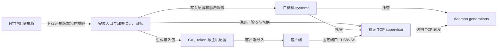

# remote-exec 一键部署设计方案

## 设计结论

目标是让用户 SSH 登录目标机器后执行一条命令，得到开机自启、TLS 和 token 鉴权正常、能够导入客户端的 remote-exec 服务。安装器负责从下载到验收的完整流程，用户只提供机器之外的信息，例如客户端访问地址。

建议采用“HTTPS 安装入口 + 自包含版本包 + systemd 托管 + 稳定 TCP 入口”的方案。首次安装直接部署 supervisor，为后续单端口无中断升级准备好入口。运行时、应用版本和部署配置分别管理，凭据放在版本目录之外。

状态：目标设计，安装脚本、发布包和恢复机制尚未实现。本文供实现与验收使用，示例域名和 CLI 均为拟议接口。现有架构和能力登记保持现状，落地时再按代码与测试维护。

## 一条命令的使用体验

默认安装命令用于 root SSH 会话，先完整下载安装器，再执行：

```bash
bash -c 'set -e; f=$(mktemp); trap "rm -f \"$f\"" EXIT; curl --fail --show-error --silent --location --proto "=https" --proto-redir "=https" --connect-timeout 10 --max-time 120 https://downloads.example.com/remote-exec/install.sh -o "$f"; bash "$f" install --endpoint 192.168.1.63 --name lab-node'
```

该命令虽然包含多个动作，用户只复制执行一次。下载失败时停止执行，完整脚本下载成功后才运行，消除下载中断导致脚本只执行了一部分的问题。正式发布前将示例域名替换为真实 HTTPS 下载入口。

普通 SSH 用户使用同样的下载过程，将执行部分改为 `sudo -n bash "$f" ...`。默认无人值守模式要求 root 或已配置免密 sudo，权限不足时在写入系统之前退出。需要输入 sudo 密码的环境，可提供 `sudo bash "$f" ...` 的单命令形式，但它属于交互式安装。

必需参数只有 `--endpoint`，表示客户端实际访问的 DNS 名或 IPv4 地址。`--name` 是可选的客户端别名，默认取校验后的 hostname。监听默认 `0.0.0.0:8791`，该端口专属于 supervisor。daemon generation 使用 `127.0.0.1:18791` 起的独立受管理端口，任何 generation 均不得占用外部端口。`--port` 仅改变外部入口，内部端口由部署 CLI 分配并持久化。客户端访问地址与监听地址分别配置。外部端口低于 1024 时，只给 supervisor unit 配置绑定低端口所需的能力，daemon 保持原权限。

成功输出包含：服务版本、监听端口、执行用户、服务状态、证书有效期、客户端接入包位置和日志查询命令。输出不包含 token 明文。发生失败时返回非零退出码，输出失败阶段、当前仍可用的版本以及下一步检查命令。

## 成立条件与支持范围

“一条命令”将环境准备收进安装器，但目标机器仍需满足可识别的运行条件。

| 条件 | 推荐首版选择 | 条件不满足时 |
| --- | --- | --- |
| 操作系统 | Ubuntu 22.04/24.04、Debian 12，systemd 正常运行 | 预检失败，列出受支持环境 |
| CPU 与 libc | x86_64、glibc，满足所选 Node 运行时要求 | 预检失败，保持已有服务 |
| 登录权限 | root 或免密 sudo | 写入前退出 |
| 基础工具 | bash、curl、tar、sha256sum、flock、OpenSSL、系统 CA | 提示缺少的工具，不隐式修改软件源 |
| 网络 | 可以访问指定 HTTPS 发布源 | 下载前后都有超时，失败保留现状 |
| 访问地址 | 用户提供稳定 DNS 名或 IPv4 字面量 | 参数校验失败 |
| 端口 | 默认 8791 可绑定 | 报告占用者，支持显式 `--port` |
| 网络准入 | 客户端到该端口的路由和访问规则已允许 | 报告外部可达性待验证 |

这些是首版产品范围，需在发布测试中确认。后续平台增加独立发布包和验收环境，安装器保持同一套流程。Node 的最低版本要求只是源码兼容范围，发布包应选用仍在维护期的 LTS，并固定到明确补丁版本。

默认不自动修改主机防火墙。已有规则、VPN、云安全组和 NAT 映射均可能参与访问控制。需要脚本管理主机防火墙时，使用明确参数和受支持的单一实现，只添加指定端口及来源 CIDR 的规则，失败回收本次添加的规则。云安全组与上游路由由对应网络管理面配置。

## 发布与运行职责

| 组件 | 职责 | 当前依据或目标落点 |
| --- | --- | --- |
| 发布流水线 | 执行测试，构建自包含包，生成版本清单与校验信息 | 现有 `package.json`、`test/upgrade/upgrade.js`；目标 CI 发布任务 |
| 薄安装入口 | 参数解析、权限和环境预检、下载校验、调用部署 CLI | 目标 `scripts/install.sh` |
| 部署 CLI | 安装锁、配置与凭据、systemd 编排、候选验收、切换、失败恢复 | 目标 `src/deploy/` |
| systemd | 开机启动、进程崩溃恢复、服务身份、日志和运行目录 | 目标 `packaging/systemd/` |
| supervisor | 持有外部端口，路由新连接，保留旧连接 | 现有 `src/supervisor/main.js`、`src/supervisor/supervisor.js` |
| daemon generation | TLS、鉴权、RPC、命令执行与文件传输 | 现有 `src/daemon/` |
| 客户端导入 | 导入 CA 与 token，合并主机配置并验证连接 | 现有 `src/client/`；目标接入包导入命令 |

安装 shell 保持薄且直线化。版本切换、恢复与验收由随包交付的 Node 部署 CLI 实现，复用现有客户端协议。systemd 托管 supervisor 与每个 daemon generation，部署 CLI 通过本机控制 socket 注册和切换后端。该路径使用现有 `register` 能力，generation 的进程生命周期统一交给 systemd。



## 自包含发布包

目标机器安装过程中不依赖 Git、npm、编译器或 npm registry。流水线把以下内容打进对应平台的版本包：

- 固定版本的 Node LTS 运行时及其许可证信息。
- `src/daemon/`、`src/supervisor/`、部署 CLI 和验收所需客户端模块。
- 根据 lockfile 安装的运行依赖，当前主要为 `ws`。
- systemd 模板、版本信息与发布清单。

版本目录绑定应用和 Node 运行时，升级后的版本可以直接回退到自己原来的运行时。系统 Node 和系统 npm 配置保持原样。

发布清单包含应用版本、平台、构建标识、包大小和 SHA-256。安装器先把 stable 解析为具体版本，再下载该版本的不可变包，后续步骤始终使用同一版本。支持 `--version` 和 `--source`，内网镜像使用相同包和清单。

首版以受信任 HTTPS 发布源作为信任起点，SHA-256 用于校验包与清单的一致性。包和哈希来自同一发布源，发布者信任仍由 HTTPS 发布源承担。若增加签名校验，公钥须随可信安装入口固定分发，包外清单提供签名。安装入口本身也提供带版本的 URL，便于审计和复现。

解包前检查归档路径、软链接目标和大小，全部内容只能落到 staging 目录。验证完成后移动到版本目录。无网络机器需要事先把自包含包和可信清单放到本机或可达内网源，再执行同一个安装入口的本地包模式；离线安装的前提是机器已经具备安装文件输入渠道。

## 目录、权限与凭据

| 路径 | 内容与权限 |
| --- | --- |
| `/opt/remote-exec/releases/<build-id>/` | 不可变版本文件，root 持有，服务用户只读 |
| `/etc/remote-exec/` | 监听配置、证书、私钥、token 哈希和 generation 启动描述 |
| `/var/lib/remote-exec/deployment.json` | 已提交的 active、previous 和事务状态，root 持有 |
| `/var/lib/remote-exec/access/` | 客户端接入包，目录 0700、文件 0600，仅 root 可读 |
| `/run/remote-exec/` | supervisor 控制 socket 和运行期文件，由 systemd 重建 |
| `/usr/local/bin/remote-exec-admin` | 本机部署、状态、升级、回滚与接入包导出入口 |

默认创建专用非 root 用户 `remote-exec`。安装器以 root 执行系统配置，远程命令以服务用户执行。需要执行特权运维命令的设备可显式选择 `--run-user root`，接入结果中展示该身份。用户选择的运行身份会直接决定 token 持有者的权限。

首次生成高熵 token、服务私钥和自签服务证书。证书 SAN 覆盖 `--endpoint`、`127.0.0.1` 和 `localhost`，客户端将这份自签证书作为可信 CA 使用，健康检查也验证证书。证书和私钥须预检匹配，证书有效期与到期提示保持可见。

证书可由发布包中的 Node 运行时调用系统 OpenSSL 生成；对应支持环境必须预检 OpenSSL 是否存在，缺失时在系统写入前失败。若最终选择携带证书生成工具，则把它纳入平台包与许可证检查，不增加目标机临时联网安装步骤。

daemon 只读取 token 哈希。首次安装为凭据交付暂存 token 明文于 root 专属接入目录，客户端导入完成后可执行显式清理命令。再次安装或升级保留 token 和证书；证书更新、token 轮换作为独立操作进行。

已有机器可以显式提供证书、私钥和 token 来源文件。文件路径进入参数，明文 token 不进入 shell 历史。默认安装生成的自签证书满足本机验收和客户端导入路径；外部 CA 证书须额外满足内部回环健康检查的证书身份验证要求，具体适配在实现前确定。

## 首次安装流程

1. **预检**：校验权限、系统、工具、地址、时间、磁盘空间及端口，识别既有安装。执行会修改系统的步骤之前取得安装锁。
2. **准备版本**：下载固定版本包与清单，校验并解包到 staging。运行所带 Node 和部署 CLI，验证运行依赖。
3. **准备配置**：建立服务用户和目录，生成或加载凭据，持久化监听参数和版本启动描述。新生成凭据在失败重试时复用。
4. **验证候选**：由 systemd 启动只监听回环地址的 daemon。用接入证书和 token 执行 TLS、WSS、无副作用命令及专属临时目录文件往返测试。
5. **建立入口**：保存初始 active 描述，安装并启用 supervisor，绑定外部端口。回环 generation 端口按受管理范围选择，绑定失败时仅重试候选，不抢占已有进程。
6. **验证固定入口**：通过外部端口再次执行真实协议验收，检查监听归属、权限、unit active/enabled 状态。
7. **验证恢复**：首次安装受控重启新建服务，检查恢复的是同一 active 版本并重复验收。
8. **提交结果**：标记安装完成，生成接入包并输出安装摘要，删除 staging 和本次临时验收文件。

首次失败时停止本次新建的服务并恢复本次修改的 unit/config，保留已生成凭据和失败日志供重试。清理只能作用于本次创建且已登记的资源。已有系统用户、目录或非本项目服务均保持原状。

已存在直接监听外部端口的旧 daemon 时，安装器返回“需要迁移”，提供显式 `migrate` 入口。迁移需要一次受控断连，停止旧进程属于显式迁移流程。

## 重复执行、升级与回滚

`install` 表示确保指定版本已正确安装：同版本且配置相同，只检查健康状态和修复可明确识别的安装缺项；版本不同则进入候选发布流程。指定了与已保存配置不同的身份、地址或端口时，返回具体差异，要求使用显式配置变更操作。普通重复执行保持访问凭据与客户端配置有效。

完成安装后，本机拟议接口为：

```bash
remote-exec-admin status
remote-exec-admin upgrade --version <version>
remote-exec-admin rollback
remote-exec-admin export-access --output /root/remote-exec-access.tar.gz
```

升级流程沿用[单入口无中断升级方案](REMOTE_EXEC_ZERO_DOWNTIME_UPGRADE.md)：新版本在独立目录与回环端口启动，完成真实协议验收后 promote，新连接进入新版本，旧连接保留。固定入口再次验收失败时自动切回旧版本。窗口内健康观察通过，且旧连接归零后才能 retire。

退役等待超时则保留旧 generation 并报告仍有连接，后台定时清理任务稍后重试，默认不强制切断旧操作。回滚窗口、观察时间和最大保留数量在配置中给出有限默认值，存在活动连接或回滚依赖的版本不会被自动删除。

普通升级保持 supervisor 进程运行，脚本不得通过 `systemctl restart supervisor` 完成 daemon 切换。supervisor 本身的更新属于独立维护操作，需要受控中断窗口。回滚改变新连接的路由，已执行的业务命令及其副作用保持既有结果。

## 持久化与重启恢复

现有 `src/supervisor/supervisor.js` 的 generation、active、previous 均存于内存。`src/supervisor/main.js` 的旧后端参数只指定端口，无法描述已经切换的新版本、TLS 验证和完整恢复关系。现有代码需要扩展后才能实现本方案。

采用一份 root 持有的部署描述作为期望状态的唯一来源，保存 active、previous、对应版本目录、回环端口、配置引用和事务中本次创建或修改的资源清单。启动命令由不可变版本与配置生成，unit 是该描述的派生结果，凭据仅保存路径引用。PID 和 socket 属于观察状态，恢复时重新获取，PID 不作为持久化进程身份。systemd 负责分别拉起 daemon 实例，supervisor 启动时读取已提交描述，等待 active 就绪，恢复后端注册和回滚关系后再开放外部端口。旧 TCP 连接只能在进程存活时保持，机器重启恢复的是新请求服务能力。

切换状态采用小型事务记录：`prepared → pending-switch → committed`。先持久化候选已通过验收及目标切换记录，再 promote，固定入口验收通过后写入 committed。原子写入包括临时文件、同步与 rename。主机在任一中间阶段重启时，恢复逻辑依据记录验证候选和旧版本，完成切换或恢复旧版本，重启恢复以完整事务记录为依据，软链接只作为版本路径引用。

启动依赖要明确：active daemon 就绪后 supervisor 才接收连接。unit 使用 `Restart=on-failure`，控制 socket 目录通过 `RuntimeDirectory` 重建。generation 的 systemd 配置和部署描述须保持一致，启动恢复负责核对版本、端口和进程身份。

恢复程序在安装锁内逐步对账：读取最后一次提交和未完成事务，检查包及配置完整性，按描述重建缺失 unit，执行 daemon-reload，启动期望 daemon 实例，再从 systemd 获取主 PID 并核对执行路径、版本、监听地址和真实协议结果，最后恢复 supervisor 路由。存活的 supervisor 通过控制 socket 查询和修正；新启动的 supervisor 在验收前保持入口关闭。每步可重复执行，失败恢复最后可用的已提交版本，并只清理事务资源清单内的候选。socket 失效时先确认 systemd 服务与真实 owner，再处理残留文件。

发布事务内由部署 CLI 负责候选故障回退；正常运行中由 systemd 重启故障进程。发布后运行故障不等于已经自动回滚，只有仍保留并通过验证的 previous 才能执行显式回滚。恢复机制必须覆盖断电、supervisor 被杀死、active daemon 崩溃与磁盘状态写入失败。

## 客户端交付与网络验收

接入包包含 `hosts.json` 片段、可信证书和 token 文件。接入包导入命令是待实现能力，现有 `src/client/config.js` 只负责读取配置。拟议接口为 `remote-exec-admin import-access <package>`，在客户端运行时无需 root。包内使用相对路径，导入器检查解包路径，写入当前用户的 0700 凭据目录，token 文件为 0600，再原子合并用户的 `hosts.json`。同名且内容一致时直接验收，同名内容不同时要求显式 `--replace`，其他主机条目保持原样。导入完成后通过实际 endpoint 执行 TLS/token/WSS 验收。客户端导入是服务安装之后的独立动作，SSH 侧一条命令无法直接修改另一台电脑的配置。

安装输出提供可复制的 SSH 下载命令和客户端导入命令，接入包只通过已有 SSH 通道或明确的安全文件传输取得。服务端不会新增无需鉴权的凭据下载端点。SSH 包下载同样要求正常主机密钥验证。

安装报告分开给出两个状态：

- **本机服务验收通过**：systemd 已启用且 active，外部监听端口可在目标机访问，TLS 身份验证、token、WSS、命令与文件往返成功，服务重启后恢复同一版本。
- **客户端连接验收通过**：实际客户端使用最终地址和凭据完成相同的认证与协议检查。覆盖路由、VPN、防火墙和云安全组。

目标机自测覆盖本机服务状态，实际客户端测试覆盖跨机器访问。安装器默认成功返回指本机验收通过，报告里明确显示外部验证状态。若要求“无人参与且外部验证也完成”才算成功，需要预先配置一个可访问目标网络的验证节点，由安装器发起认证验证并等待结果。

经 relay 使用时，接入配置还需要客户端已有的网关别名 `via`。网关证书和 token 独立管理，目标安装器仅生成目标凭据；relay 不支持的上传下载能力按现有协议边界展示。

## 验收场景

| 场景 | 可观察结果 |
| --- | --- |
| 干净机器，无系统 Node/npm | 一条命令完成安装，系统运行时保持原样 |
| root、免密 sudo、无 sudo 权限 | 前两者成功，第三者在写入前失败 |
| 下载超时、截断、错误哈希、非法归档路径 | 包不执行、不进入版本目录，已有服务仍可用 |
| 平台不支持、磁盘不足、端口被其他进程占用 | 明确失败原因，已有进程保持运行 |
| 首次安装成功后重启服务与整台机器 | 同一 active 版本自动恢复，实际客户端能重新连接 |
| 同命令执行两次、两个安装并发 | 单实例操作，同版本不重复轮换凭据、不重启健康服务 |
| 错误 endpoint、证书 SAN 不匹配、错误 token | 本机或客户端验收失败，不输出整体接入成功 |
| 候选启动失败或固定入口验收失败 | 旧版本持续可用或恢复可用，不重放业务命令 |
| 两轮升级期间保持 exec、流式输出与文件传输 | 复用现有升级门禁证明旧操作完成、新连接可用 |
| 切换各阶段强制终止、磁盘写入失败后重启 | 恢复到可定位的提交状态，凭据保持有效 |
| 旧版本存在长连接 | 保留该版本并报告等待状态，不自动删除 |
| 实际客户端导入接入包 | TLS 验证开启，主机配置合并，原有主机保持可用 |
| 旧 daemon 直接占用端口 | 普通安装报告迁移需求，显式迁移单独验收 |

安装测试应使用受支持平台的可重建 VM，真实运行 systemd 和机器重启。现有 `npm test` 和 `test:upgrade` 继续作为发布门禁，新增安装测试验证机器侧交付结果，命令调用模拟用于补充单元检查。

## 实施顺序与发布前决策

首版必须交付在线安装、固定版本包、专用用户、自签服务证书、systemd 与 supervisor、持久化恢复、幂等执行、daemon 升级回滚、接入包及客户端导入。现有直接 daemon 的迁移在首版只负责识别并返回迁移需求。完整离线分发、外部 CA 适配、自动 token 轮换、主机防火墙代管、独立签名体系和外部验证节点列为扩展项，前文描述用于明确接口方向与成立条件。

完整交付包括发布包、安装入口、部署 CLI、systemd 配置、supervisor 状态恢复、客户端接入导入和 VM 验收。实施先固定版本包与运行环境，再实现首次安装与接入交付，随后补齐切换事务及重启恢复，最后执行安装和升级门禁。对外发布的一键部署入口须等待完整验收通过。

发布前需要落定的外部配置为：正式 HTTPS 下载域名与镜像、首版 Node LTS 补丁版本和平台包、服务默认身份，以及是否需要外部验证节点。本文默认专用用户、自签服务证书、8791 端口、用户显式指定 endpoint、本机验收成功后输出接入包。

## 设计取舍与依据

- 采用独立 Node 运行时和运行依赖包。已有 HG1 部署经验验证了独立运行时与 systemd 的可行性；该实例为直接 daemon、root 身份，提供运行时分发经验；本方案的完整安装和恢复流程仍待验收。
- 首次建立 supervisor。独立评审提出“先用单 daemon 安装”可以减少首版工作量，但它会把稳定入口迁移的断连留给用户，故选择一次完成入口部署及恢复能力。
- 采纳独立评审提出的运行时自包含、证书 SAN、凭据交付、幂等安装和重启验收要求，特别补充内存切换状态丢失后的持久化设计。
- 使用自签服务证书作为客户端信任锚，复用现有 `ca` 配置，减少独立 CA 私钥的管理负担。证书签发和轮换扩展为单独运维操作。
- 暂不增加 Docker、跨所有发行版的软件源适配或常驻编排平台。systemd、现有 supervisor 和小型部署 CLI 已覆盖目标流程。

现有代码依据：[daemon 启动入口](../../src/daemon/main.js)、[supervisor 控制与路由](../../src/supervisor/supervisor.js)、[supervisor 启动参数](../../src/supervisor/main.js)、[真实升级门禁](../../test/upgrade/upgrade.js)、[当前部署说明](../../README.md)。
