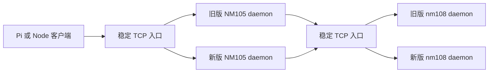

# remote-exec 无中断升级方案

## 目标和结论

本文面向负责维护 remote-exec 的开发和运维人员，帮助他们决定如何升级 NM105、nm108 及测试环境而不主动中断已经建立的远程执行连接。

当前实现不能通过 `systemctl restart` 实现无中断升级。daemon 自己监听业务端口，WebSocket、relay、上传下载和正在执行的命令都绑定在旧进程内。旧进程退出时，连接关闭会触发命令取消。因此，升级方案必须先把固定入口从 daemon 进程中独立出来，再增加旧版本排空能力。

推荐采用“稳定 TCP 入口 + 双版本 daemon + 连接排空”的方式：

- 由 HAProxy、Nginx stream 或同类 TCP 代理长期持有 443/8791 入口，代理只做 TLS 透传和连接路由。
- 每个 daemon 版本使用独立目录和独立本地端口，例如 `18791`、`28791`，禁止新旧版本抢占同一端口。
- 代理把新连接切到新版本，已经建立的连接继续由旧版本处理。
- 旧版本进入 drain 状态后拒绝新连接，但继续处理已有 WebSocket、relay、上传和下载，直到活动数归零或达到排空期限。
- NM105 先升级并观察，再升级 nm108。NM105 是 relay 网关，必须先保证网关可用，再验证它到 nm108 的链路。

这个方案保证的是“升级不主动切断既有连接”。超过排空期限仍未结束的命令和传输会被强制终止，当前协议没有会话迁移能力，不能承诺强制期限内的命令无损续接。

## 目标架构



代理只负责新连接的分配，不转移已经建立的 TCP/WebSocket 连接。旧 daemon 继续拥有旧连接，新 daemon 只接收切换后的新连接。

代理后端必须记录 generation，例如 `nm105-old`、`nm105-new`、`nm108-old`、`nm108-new`。切换时只改变新连接的后端，不删除旧后端，直到排空完成。

## daemon 必须补齐的能力

### Drain 生命周期

daemon 增加以下状态：

- `starting`：进程已启动，正在校验配置和监听本地端口。
- `ready`：可以接受新连接。
- `draining`：拒绝新的 WebSocket Upgrade、上传和下载，保留已有连接。
- `stopped`：监听关闭，活动连接和请求已清理。

`/healthz` 表示进程仍然存活，`/readyz` 只有 `ready` 状态返回成功。进入 `draining` 后 `/readyz` 必须返回非 200，代理据此停止向该 generation 分配新连接。

### 活动资源计数

daemon 至少记录并暴露：

- 已建立 WebSocket 数量。
- 执行中的 `exec` 和 `exec.stream` 数量。
- 活动 relay 数量。
- 活动上传和下载数量。
- generation 标识和版本标识。
- drain 开始时间和排空截止时间。

只有 WebSocket、relay、HTTP 传输和执行请求全部归零，旧 generation 才能正常退出。

### 退出流程

收到 `SIGTERM` 后：

1. 标记为 `draining`。
2. 立即让 `/readyz` 失败。
3. 停止接受新的 Upgrade、上传和下载。
4. 保持现有连接和请求。
5. 在排空期限内持续报告活动资源。
6. 活动资源归零后关闭监听并退出。
7. 到达期限仍有活动资源时，记录强制终止原因，再关闭剩余连接和进程组。

`TimeoutStopSec` 必须大于 daemon 的最大排空期限。命令、relay、流式输出和 HTTP 传输的最大生命周期要统一纳入这个计算，不能依赖 systemd 默认值。

## 版本发布结构

每台主机保留不可变版本目录：

```text
/opt/remote-exec/releases/<version>/
/etc/remote-exec/server.crt
/etc/remote-exec/server.key
/etc/remote-exec/token.sha256
/var/log/remote-exec/<generation>.log
```

证书、私钥和 token hash 不跟随版本目录删除。发布包启动前校验：

- 版本目录和入口文件完整。
- Node.js 版本满足项目要求。
- `node_modules/ws` 存在且可加载。
- 证书、私钥和 token hash 可读，权限符合要求。
- 监听本地端口未被其他进程占用。
- 配置中的主机名、端口和证书 SAN 相互匹配。

## xiaomi 验证计划

xiaomi 作为第一阶段环境，验证从客户端到 daemon、代理和回滚的完整行为。测试服务必须使用独立目录、独立端口、独立 token hash 和测试证书，不能复用正式 remote-exec 入口。

### 阶段一：只读基线

通过免密 SSH 连续三次确认：

```bash
ssh -o BatchMode=yes \
  -o StrictHostKeyChecking=yes \
  -o ConnectTimeout=10 \
  root@xiaomi 'hostname && id -un && node --version'
```

记录 daemon 的启动方式、端口 owner、Node 版本、工作目录、日志位置和 systemd unit。不得关闭主机密钥校验，不得输出 token、私钥或完整敏感配置。

### 阶段二：独立端口启动

在 xiaomi 使用候选版本启动两个本地 daemon：

- `xiaomi-old`：模拟当前版本。
- `xiaomi-new`：模拟候选版本。

两者分别监听不同本地端口，由代理监听固定测试入口。验证：

- 正确和错误 token。
- TLS 证书校验和 SAN。
- `exec`、`exec.stream`、`file.read`、`file.write`。
- 命令超时和断连后的整个进程组清理。
- relay 普通调用、流式调用、目标不可达、目标认证失败和目标证书失败。
- 上传下载的字节数和 SHA-256。

### 阶段三：连接排空演练

在 `xiaomi-old` 上保持以下活动：

- 一个持续输出的直连 `exec.stream`。
- 一个经 relay 的 `exec.stream`。
- 一个上传或下载。
- 一个普通 `exec`。

然后执行切换：

1. 新建 `xiaomi-new`，等待 `/readyz` 成功。
2. 代理将新连接切换到 `xiaomi-new`。
3. 旧版本进入 `draining`。
4. 检查旧连接仍能收到完整输出和终态响应。
5. 检查新连接全部进入新版本。
6. 等待旧版本活动计数归零。
7. 确认旧版本退出且没有遗留命令进程组。

验收条件：

- 已建立的流式连接没有因为切换被主动关闭。
- 每个请求只收到一个终态响应。
- 新连接不会进入旧版本。
- 旧版本在活动数归零后自动退出。
- 失败时可以把新连接路由回旧版本。

### 阶段四：失败和回滚演练

分别模拟以下失败：

- 新版本配置错误，无法启动。
- 新版本 TLS 或 token 错误。
- 新版本 `/readyz` 失败。
- 新版本真实 RPC 冒烟失败。
- 新版本运行后异常退出。
- 旧版本排空超时。

回滚规则：

1. 先停止向新版本分配连接。
2. 将新连接路由回旧版本。
3. 保留旧版本已有连接和活动请求，直到它们结束。
4. 停止新版本并保留日志。
5. 重新执行健康检查和真实 RPC 冒烟。

不允许先删除旧版本目录、旧证书或旧 token，再判断新版本是否可用。

## NM105 和 nm108 推广顺序

### 第一阶段：NM105

先在 NM105 上部署新版本到备用本地端口，验证：

- 直连 TLS、token、exec 和 exec.stream。
- NM105 作为 relay 网关时，目标错误能区分网络、认证和证书失败。
- 旧 NM105 连接在切换后继续完成。
- 新连接全部进入新 generation。

观察至少 30 分钟。期间不修改 nm108。

### 第二阶段：nm108

确认 NM105 稳定后，在 nm108 上部署新版本到备用本地端口，链路固定为：

```text
xiaomi -> NM105 稳定入口 -> nm108 稳定入口 -> nm108 新 generation
```

升级 nm108 时，NM105 保持不变。验证通过后观察至少 30 分钟，再决定是否升级 NM105 的另一 generation。

### 第三阶段：NM105 第二次切换

nm108 新版本稳定后，再切换 NM105。这样可以避免同时改变 relay 网关和目标 daemon，使故障定位保持单一变量。

## 发布门禁和回滚条件

以下任一条件不满足，停止切换并回滚新连接路由：

- 本地 `npm test` 未通过。
- 新 generation `/readyz` 不成功。
- 真实 WebSocket Upgrade、认证、exec、exec.stream 或 relay 冒烟失败。
- 代理后端状态与 generation 标识不一致。
- 新旧版本同时监听同一个 daemon 端口。
- 已建立流式连接出现丢包、乱序、重复或缺少终态。
- 上传下载校验失败。
- 旧 generation 活动数不下降或子进程组残留。
- 新版本异常退出、重复重启、资源持续增长。
- 任何非幂等请求的执行状态无法确认。

回滚只能保护尚未切换的新连接。当前协议不支持恢复已经断开的 WebSocket、已经终止的命令或已经提交但没有返回结果的非幂等请求。此类请求必须停止自动重试，保留日志并人工确认执行状态。

## 需要用户确认的动作

以下动作进入实施阶段前逐项确认：

- 在 xiaomi 写入测试目录、证书、token hash 或 systemd unit。
- 在 xiaomi 启动备用 daemon 和代理。
- 在 NM105 或 nm108 上传新版本并启动备用 generation。
- 修改代理后端和固定入口路由。
- 让旧 generation 进入 drain 或停止旧服务。
- 删除旧版本、关闭备用端口或轮换证书和 token。

在完成 xiaomi 的独立端口、连接排空和回滚演练前，不进入 NM105 或 nm108 的正式切换。
