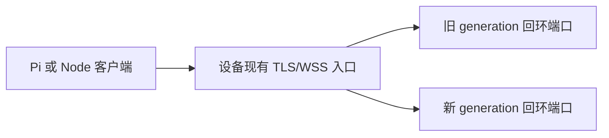

# remote-exec 单入口无中断升级方案

## 目标与硬约束

目标设备只开放现有 remote-exec TLS/WSS 入口，设备可能没有 SSH、备用 TCP 端口或其他管理面。xiaomi 具备免密 SSH，只用于隔离实验和验证升级机制，不能作为目标设备正式升级或回滚的依赖。

当前 daemon 直接监听业务端口，WebSocket、relay、上传下载和执行中的命令都属于当前进程。连接关闭会取消执行中的操作。当前代码也没有监听 socket 交接、连接迁移、drain 状态或 generation 管理，因此直接 `systemctl restart` 会造成连接中断。

严格结论：

- 后续升级可以实现“不主动切断已有连接”。
- 首次把现有 daemon 迁移为可热升级架构时，当前代码无法同时保证已有连接不断开。首次 bootstrap 必须有一次受控切换窗口，或者提前在当前版本中安装好端口交接能力。
- 一旦稳定入口已经预先部署，后续升级可以在只有一个外部端口、没有 SSH 的设备上完成。
- 设备完全失联时，如果没有本地控制台或带外管理，任何远程方案都无法修复入口组件自身的故障。

## 推荐架构

固定入口由长期运行的入口所有者持有，daemon generation 只监听本机回环端口：



入口可以是 HAProxy、Nginx stream 或项目自带的轻量 supervisor。它只负责 TCP 连接保持和后端分配，TLS 继续由 daemon generation 终止。设备对外仍只有原来的一个端口。

入口必须提前接管现有端口。正式升级时不能先停止旧 daemon，再临时安装入口，否则端口会出现中断窗口。入口切换新连接时，已经建立的 TCP/WebSocket/HTTP 连接继续留在旧 generation。

新旧 generation 使用不同的本机回环端口，例如：

```text
固定外部端口 -> 127.0.0.1:18791 旧版本
              -> 127.0.0.1:28791 新版本
```

两个回环端口不能监听 `0.0.0.0`，也不能写入客户端主机清单。

## daemon 生命周期

每个 generation 使用以下状态：

```text
starting -> ready -> draining -> stopped
```

`/healthz` 表示进程存活，`/readyz` 只有 `ready` 状态返回成功。进入 `draining` 后，generation 拒绝新的 WebSocket Upgrade、上传和下载，保留已经建立的连接和传输。

daemon 必须跟踪：

- WebSocket 连接数。
- 执行中的 `exec` 和 `exec.stream` 数量。
- 活动 relay 数量。
- 活动上传和下载数量。
- generation、版本、drain 开始时间和截止时间。

收到 `SIGTERM` 后：

1. 标记 `draining`。
2. 让 `/readyz` 失败，入口停止分配新连接。
3. 停止接受新的 Upgrade、上传和下载。
4. 保留已有连接和请求。
5. 活动资源归零后关闭服务并退出。
6. 到达排空期限仍有活动资源时，记录强制终止原因，再关闭连接和进程组。

已有 WebSocket 在 drain 后是否允许提交新的 RPC，需要在实现阶段固定一种语义。推荐 drain 后只完成已经开始的 RPC，并对同一连接后续消息返回明确的 draining 错误，避免旧连接无限延长退出时间。

## 单入口下的首次 bootstrap

### 方案一：允许一次受控切换

这是当前代码可以实施的路径：

1. 通过现有 remote-exec 连接确认版本、端口、启动参数、凭据和回滚包。
2. 通过现有认证能力写入入口组件、候选版本和本机回环配置。
3. 在设备上校验 Node.js、依赖、证书、私钥、token hash 和端口。
4. 在维护窗口内停止当前 daemon。
5. 启动入口组件，让它持有原固定端口。
6. 由入口启动旧版本 generation，确认真实 WSS 和 RPC 可用。
7. 把旧 generation 标记为 active，完成 bootstrap。
8. 保存入口、旧版本和回滚配置。

该过程会断开已有 WebSocket，正在执行的命令和传输可能被取消。必须在实施前确认维护窗口和业务影响。

### 方案二：首次 bootstrap 也要求零断连

当前代码无法满足。需要先让当前 daemon 具备以下至少一项能力：

- 把已监听 socket 传递给新 supervisor。
- 由当前 daemon 启动并交接入口所有权。
- 新旧进程共享受控的监听 socket，并由旧进程保留已建立连接。
- 持久化命令和传输状态，使新进程能够接管旧请求。

这些能力自身需要一次可执行的安装渠道。只有现有 daemon、没有备用管理面时，无法从零开始证明首次 bootstrap 不会中断。这个边界必须作为发布前决策门，而不是留到升级过程中处理。

## 后续升级流程

完成 bootstrap 后，设备不需要 SSH 或额外外部端口：

1. 通过现有入口上传候选版本到不可变目录。
2. 校验发布包 SHA-256 或签名。
3. 校验证书、私钥、token hash、依赖和本机回环端口。
4. 启动候选 generation。
5. 通过固定入口执行真实 TLS、token、WebSocket、exec、exec.stream、文件和 relay 冒烟。
6. 把入口的新连接切换到候选 generation。
7. 把旧 generation 标记为 `draining`。
8. 保持并观察旧 generation 上的长连接、relay、上传、下载和命令。
9. 活动资源归零后停止旧 generation。
10. 保留旧版本、旧日志和旧启动配置，直到观察窗口结束。

入口控制操作优先使用本机 Unix socket 或父子进程控制通道，不新增对外 TCP 管理端口。升级命令不能关闭承载当前控制连接的入口组件。

## xiaomi 隔离验证

xiaomi 用于验证完整机制，不代表目标设备具备 SSH。测试环境使用独立目录、测试证书、测试 token hash、固定测试入口和两个回环 generation。

### 基线

连续三次执行：

```bash
ssh -o BatchMode=yes \
  -o StrictHostKeyChecking=yes \
  -o ConnectTimeout=10 \
  root@xiaomi 'hostname && id -un && node --version'
```

确认测试入口、端口 owner、进程管理方式、日志位置和回滚材料。禁止关闭主机密钥校验，禁止打印正式 token 和私钥。

### 协议与资源验证

分别验证：

- 正确和错误 token。
- TLS 证书校验和 SAN。
- WebSocket Upgrade。
- `exec`、`exec.stream` 和超时。
- `file.read`、`file.write`、上传和下载哈希。
- relay 正常调用、流式调用、目标不可达、目标认证失败和目标证书失败。
- 客户端主动断开后的完整进程组清理。

### 连接排空验证

在旧 generation 上同时保持：

- 直连流式命令。
- relay 流式命令。
- 上传或下载。
- 普通命令。

然后：

1. 启动新 generation 并等待 ready。
2. 把新连接切换到新 generation。
3. 让旧 generation 进入 drain。
4. 确认旧连接输出完整、终态只返回一次。
5. 确认新连接全部进入新 generation。
6. 等待旧 generation 活动数归零。
7. 确认旧 generation 退出且没有遗留命令进程组。

### 失败与回滚验证

覆盖以下情况：

- 新版本无法启动。
- 新版本 ready 失败。
- TLS、token 或 RPC 冒烟失败。
- 新版本运行中异常退出。
- 旧 generation 排空超时。

回滚步骤：

1. 停止向新 generation 分配连接。
2. 把新连接路由回旧 generation。
3. 保留旧 generation 已有连接。
4. 验证旧版本真实 WSS、exec、exec.stream 和 relay。
5. 停止新 generation，保留失败日志和版本目录。

## 推广顺序

### NM105

先在 NM105 上完成候选 generation 的本机回环验证，再观察直连和 relay 网关行为至少 30 分钟。此阶段不切换 nm108。

### nm108

NM105 稳定后，通过现有 relay 入口升级 nm108。链路为：

```text
xiaomi 或 Pi -> NM105 现有入口 -> nm108 现有入口 -> nm108 generation
```

NM105 保持不变，单独验证 nm108 新旧 generation 的连接排空和回滚。

### NM105 第二次切换

nm108 稳定后再切换 NM105。两端不能同时切换，否则无法区分网关故障和目标故障。

## 凭据与端口规则

- TLS 证书、私钥和 token hash 放在版本目录之外。
- 新旧 generation 在一次升级期间使用同一个 token hash。
- token 轮换和 daemon 升级分开执行。
- 固定外部端口只能由入口所有者监听。
- generation 只监听本机回环端口。
- 入口配置切换不释放固定端口。
- 旧版本、旧凭据和旧启动配置在观察窗口结束前保留。
- 日志中不得出现 token、私钥和完整敏感配置。

## 发布门禁

任一门禁失败，保持旧 generation active：

- 本地 `npm test` 通过。
- 发布包校验一致且依赖完整。
- 固定入口 owner 正确，generation 端口只在回环地址监听。
- 候选版本通过真实 TLS、token、WebSocket、exec、exec.stream、文件和 relay 验证。
- 新旧 generation 的活动资源可观察。
- 长连接、relay 流、上传下载能够完整排空。
- 新版本启动失败、ready 失败和运行中退出时，旧版本仍可用。
- 任何状态未知的非幂等请求都不会自动重放。

## 无法保证的边界

- 设备崩溃、断电、网络断开和入口组件故障无法通过本方案恢复已断开的连接。
- 排空期限到达后，仍未结束的命令、relay 或传输会被强制终止。
- 当前协议无法恢复已经断开的 WebSocket，也无法判断连接断开时非幂等命令是否已经产生副作用。
- 没有任何带外管理面时，入口组件自身损坏后只能依赖本地控制台或设备侧自动恢复机制。

## 实施前确认项

进入实施前需要逐项确认：

- 是否允许首次 bootstrap 的受控断连窗口。
- 目标 daemon 当前由 systemd、supervisor 还是手工进程托管。
- 是否具备在现有 remote-exec 用户权限下写入版本和入口配置的条件。
- 是否已预先安装入口所有者，或明确接受首次安装中断。
- 排空期限、强制终止策略和长命令业务边界。
- NM105 与 nm108 的逐台观察窗口和回滚负责人。

本方案未执行远程写入、启动、重启或端口切换。
